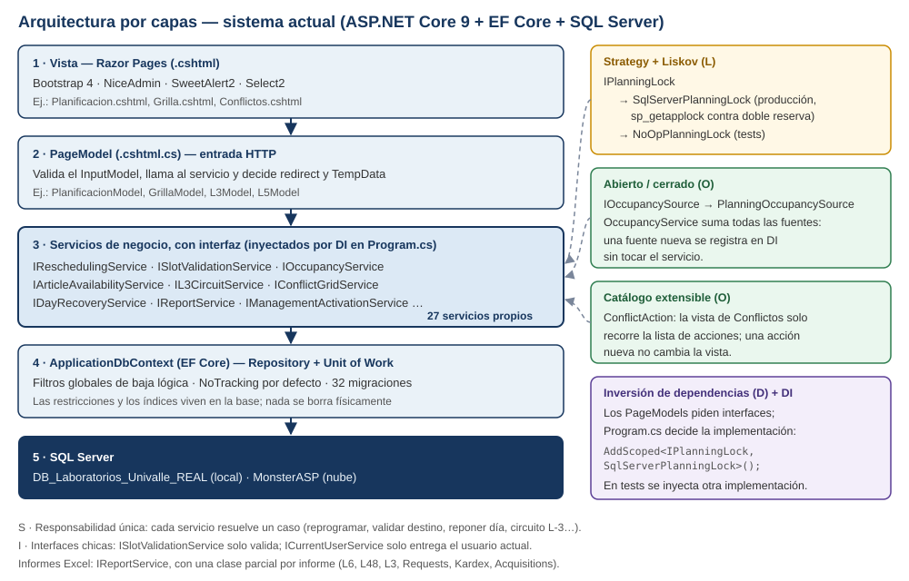

# Arquitectura: principios SOLID y patrones de diseño

**Proyecto:** Laboratorios Univalle — Gastronomía
**Periodo:** Sprint 2 (29/09/2026 → 26/10/2026)
**Stack:** ASP.NET Core 9 (Razor Pages) · Entity Framework Core 9 · SQL Server · Bootstrap 4 / NiceAdmin

---

## 1. Contexto

En el Sprint 1 se presentó un diagrama de SOLID y patrones pensado para la migración a NestJS. Usaba clases que hoy no existen: `UserService`, `IUserRepository`, `PostgresUserRepository`, `BcryptVerifier` y `AspNetIdentityAdapter`. Esa migración se descartó.

Este documento muestra que **los mismos principios se aplicaron en el sistema que hoy funciona**, con clases reales que se pueden abrir en el repositorio. En especial se aplicaron en el módulo de Planificación, que se construyó en este sprint.



---

## 2. Capas

| Capa | Responsabilidad | Ejemplo real |
|---|---|---|
| Vista (Razor `.cshtml`) | Mostrar y capturar datos | `Pages/LaboratoryOperations/Planificacion.cshtml` |
| PageModel (`.cshtml.cs`) | Recibir la petición HTTP, validar el formulario y decidir a dónde redirigir | `Planificacion.cshtml.cs` |
| Servicios con interfaz | Reglas de negocio: reprogramar, validar destino, disponibilidad, circuito L-3… | `Services/ReschedulingService.cs` |
| `ApplicationDbContext` (EF Core) | Acceso a datos: consultas, transacciones y filtros de baja lógica | `Data/ApplicationDbContext.cs` |
| SQL Server | Persistencia, restricciones e índices | `DB_Laboratorios_Univalle_REAL` |

---

## 3. Cada principio, con su evidencia en el código

### S · Responsabilidad única
Cada servicio de Planificación resuelve **un solo caso de uso**:

| Servicio | Única responsabilidad |
|---|---|
| `SlotValidationService` | Decidir si un destino (ambiente, día y periodos) es válido |
| `ReschedulingService` | Mover una planificación a otro horario |
| `DayRecoveryService` | Suspender un día y reponer sus prácticas |
| `ArticleAvailabilityService` | Calcular si el material alcanza |
| `L3CircuitService` | Entrega y devolución del material de una práctica |
| `ConflictGridService` | Armar la vista semanal de conflictos |

Los **informes Excel** están en `IReportService`, separados en un archivo por informe: `ReportService.L6.cs`, `.L48.cs`, `.L3.cs`, `.Requests.cs`, `.Kardex.cs` y `.Acquisitions.cs`.

### O · Abierto / cerrado
**Fuentes de ocupación.** `OccupancyService` no sabe de dónde viene la ocupación: suma todas las `IOccupancySource` registradas. Para agregar otra fuente (por ejemplo, los bloqueos manuales de un ambiente) basta con registrarla, sin modificar el servicio.

```csharp
// Services/Occupancy/OccupancyModels.cs
public interface IOccupancySource
{
    Task<IReadOnlyList<OccupancyBlock>> GetAsync(OccupancyQuery query, CancellationToken ct = default);
}

// Services/Occupancy/OccupancyService.cs
public OccupancyService(IEnumerable<IOccupancySource> sources) => _sources = sources.ToList();
```

**Acciones de conflicto.** La pantalla de Conflictos solo recorre una lista de `ConflictAction`. Hoy tiene 7: actualizar stock, registrar unidad, reprogramar, reducir cantidad, materiales, ver en grilla y suspender día. Una acción nueva se agrega a la lista sin tocar la vista.

```csharp
// Services/ConflictGridService.cs
public sealed record ConflictAction(string Key, string Label, string Icon, ConflictActionScope Scope,
    string? Url, bool Enabled, string? DisabledReason, string Style);
```

### L · Sustitución de Liskov
`IPlanningLock` evita que dos personas reserven el mismo ambiente y día al mismo tiempo. Tiene **dos implementaciones intercambiables**, y quien la usa no nota la diferencia:

```csharp
// Services/PlanningLock.cs
public interface IPlanningLock
{
    Task<bool> TryAcquireAsync(IEnumerable<string> resources, CancellationToken ct = default);
}

public sealed class SqlServerPlanningLock : IPlanningLock { /* sp_getapplock, 10 s de espera */ }

public sealed class NoOpPlanningLock : IPlanningLock
{
    public Task<bool> TryAcquireAsync(IEnumerable<string> resources, CancellationToken ct = default)
        => Task.FromResult(true);
}
```

En producción se usa la de SQL Server. En los tests (`Tests/Laboratorios.Tests/DayRecoveryServiceTests.cs`) se inyecta la nula, y `DayRecoveryService` funciona igual.

### I · Segregación de interfaces
Las interfaces son chicas y se enfocan en un solo consumidor:
- `ISlotValidationService` solo valida;
- `IReschedulingService` solo reprograma;
- `ICurrentUserService` solo entrega el usuario actual.

Ningún consumidor depende de métodos que no usa.

### D · Inversión de dependencias + inyección
Los PageModels y los servicios piden **interfaces**; `Program.cs` decide qué implementación se entrega. Hay **27 servicios propios** registrados así:

```csharp
// Program.cs (extracto)
builder.Services.AddScoped<ISlotValidationService, SlotValidationService>();
builder.Services.AddScoped<IPlanningLock, SqlServerPlanningLock>();
builder.Services.AddScoped<IReschedulingService, ReschedulingService>();
builder.Services.AddScoped<IDayRecoveryService, DayRecoveryService>();
builder.Services.AddScoped<IL3CircuitService, L3CircuitService>();
builder.Services.AddScoped<IArticleAvailabilityService, ArticleAvailabilityService>();
builder.Services.AddScoped<IConflictGridService, ConflictGridService>();
```

Gracias a esto, los **402 tests unitarios** pueden probar cada regla con dependencias controladas.

---

## 4. Patrones de diseño

| Patrón | Dónde | Para qué |
|---|---|---|
| **Strategy** | `IPlanningLock` (SQL Server o nulo); `IOccupancySource` | Cambiar el comportamiento sin cambiar a quien lo usa |
| **Repository + Unit of Work** | `ApplicationDbContext` (EF Core) | EF Core ya implementa ambos: cada `DbSet` es un repositorio y `SaveChanges` confirma todo junto |
| **Inyección de dependencias** | Contenedor de ASP.NET Core (`Program.cs`) | Bajo acoplamiento y pruebas |
| **Filtro global (soft-delete)** | 38 filtros de consulta en `ApplicationDbContext` | Nada se borra físicamente; lo dado de baja se oculta solo |
| **Catálogo de comandos** | `ConflictAction` | Acciones extensibles en la vista de Conflictos |

---

## 5. Del diagrama del Sprint 1 al sistema actual

| Diagrama del Sprint 1 (NestJS, descartado) | Equivalente real hoy |
|---|---|
| React → Controller → Service → Repository → PostgreSQL | Razor Page → PageModel → Servicio con interfaz → `ApplicationDbContext` → SQL Server |
| `UserService` depende de `IUserRepository` | Los servicios dependen de interfaces (`IPlanningLock`, `IOccupancySource`…) inyectadas por `Program.cs` |
| `PostgresUserRepository` | `ApplicationDbContext` (EF Core) |
| Strategy `PasswordVerifier` | Strategy `IPlanningLock` / `IOccupancySource` |
| Adapter de hash ASP.NET Identity → bcrypt | **Ya no hace falta**: al seguir con ASP.NET Identity, no hay contraseñas que adaptar |

---

## 6. Límites (transparencia)

- **No hay una capa Repository propia.** El rol lo cumple `ApplicationDbContext`, que es la práctica recomendada con EF Core.
- **La mayoría de los PageModels usan EF Core directamente (139 de 153).** Es el patrón estándar de Razor Pages para pantallas de alta, edición y listado simples. La lógica compleja, sobre todo la de Planificación, sí está en servicios con interfaz. Sacar las consultas de los PageModels de mantenimiento antiguos sería una mejora futura, no un requisito.
- **SOLID se aplicó donde aporta:** en las reglas que cambian y que necesitan pruebas. No se forzó en pantallas simples.
