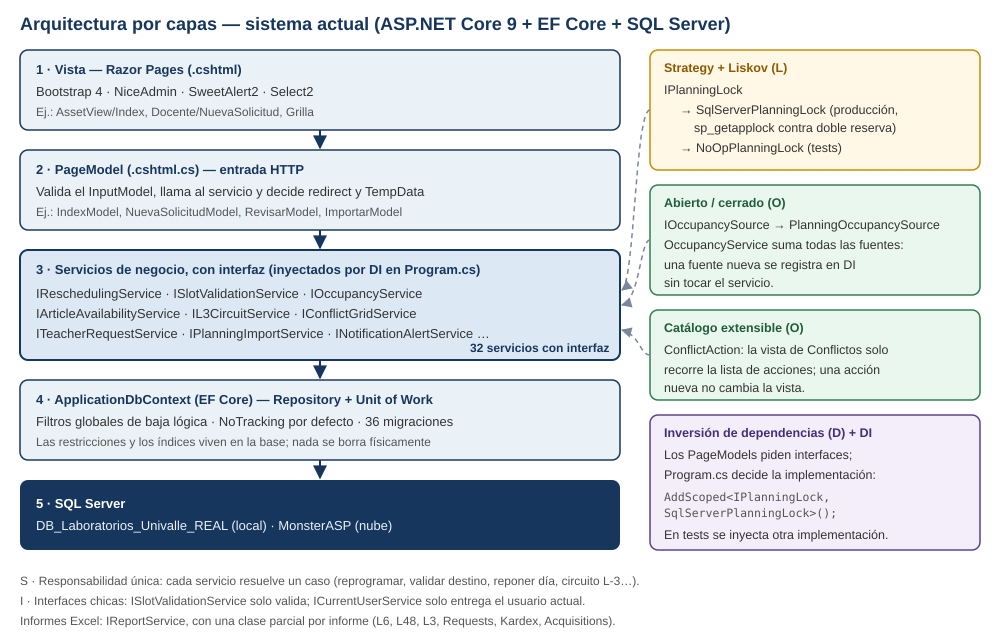

# Arquitectura: principios SOLID y patrones de diseño

**Proyecto:** Laboratorios Univalle — Gastronomía
**Periodo:** Sprint 3 (27/10/2026 → 18/11/2026)
**Stack:** ASP.NET Core 9 (Razor Pages) · Entity Framework Core 9 · SQL Server · Bootstrap 4 / NiceAdmin

---

## 1. Contexto

La arquitectura del Sprint 2 no cambió: el sistema sigue siendo una aplicación Razor Pages con servicios de negocio detrás de interfaces. Lo que este sprint demuestra es que esa estructura **soportó un módulo grande sin reescribir lo anterior**. El circuito docente reutiliza ocupación, disponibilidad de material, bloqueo de agenda, gestión académica y horarios de grupos.



---

## 2. Capas

| Capa | Responsabilidad | Ejemplo real |
|---|---|---|
| Vista (Razor `.cshtml`) | Mostrar y capturar datos | `Pages/Docente/NuevaSolicitud.cshtml` |
| PageModel (`.cshtml.cs`) | Recibir la petición, validar y decidir la respuesta | `Pages/LaboratoryOperations/Solicitudes/Revisar.cshtml.cs` |
| Servicios con interfaz | Reglas de negocio | `Services/TeacherRequests/TeacherRequestService.cs` |
| `ApplicationDbContext` (EF Core) | Consultas, transacciones y filtros de baja lógica | `Data/ApplicationDbContext.cs` |
| SQL Server | Persistencia, restricciones e índices | `DB_Laboratorios_Univalle_EXP` (pruebas) |

**Medido el 18/11:** 164 PageModels, 32 servicios registrados por interfaz, 39 filtros globales y 36 migraciones.

---

## 3. Cada principio, con su evidencia en el código

### S · Responsabilidad única
Las funciones nuevas se agregaron como servicios separados:

| Servicio | Única responsabilidad |
|---|---|
| `TeacherRequestService` | Ciclo de vida de la solicitud del docente |
| `PlanningImportService` | Plantilla, revisión y carga del semestre desde Excel |
| `ManagementPlanBackfillService` | Reconstruir los equipos de cada gestión |
| `NotificationAlertService` | Armar y clasificar los avisos |
| `InicioPanelService` | Preparar los datos de la semana para el Inicio |
| `ArticleAvailabilityService` | Calcular si el material alcanza |

### O · Abierto / cerrado
`OccupancyService` no sabe de dónde viene la ocupación: suma todas las fuentes registradas. La solicitud del docente la usa sin modificarlo.

```csharp
// Services/Occupancy/OccupancyModels.cs
public interface IOccupancySource
{
    Task<IReadOnlyList<OccupancyBlock>> GetAsync(OccupancyQuery query, CancellationToken ct = default);
}

// Services/Occupancy/OccupancyService.cs
public OccupancyService(IEnumerable<IOccupancySource> sources) => _sources = sources.ToList();
```

La pantalla de Conflictos mantiene el mismo criterio: recorre una lista de `ConflictAction`, que hoy tiene 7 acciones.

### L · Sustitución de Liskov
`IPlanningLock` protege las operaciones que no pueden cruzarse. El servicio docente lo usa sin saber qué implementación recibe:

```csharp
// Services/TeacherRequests/TeacherRequestService.cs
if (!await _lock.TryAcquireAsync([PlanningLockResources.Planning(planningId)]))
    return TeacherOpResult.Fail(PlanningLockResources.BusyMessage + ".");
```

| Implementación | Dónde se usa |
|---|---|
| `SqlServerPlanningLock` | Aplicación real, con `sp_getapplock` |
| `NoOpPlanningLock` | Pruebas de planificación |
| `AlwaysFreeLock` | Pruebas del servicio docente |
| `InProcessPlanningLock` | Host de pruebas de la Práctica 3 |

### I · Segregación de interfaces
Quien solo escribe un aviso no depende de los métodos de lectura de la bandeja:

```csharp
// Services/Notifications/NotificationContracts.cs
public interface IMaintenanceNotificationWriter
{
    Task NotifyAssignmentAsync(int maintenanceId, CancellationToken cancellationToken = default);
}
```

`IInicioPanelService` también es pequeña: expone solo `GetWeekAsync` y `GetWeeklySeriesAsync`.

### D · Inversión de dependencias + inyección
`TeacherRequestService` pide abstracciones y `Program.cs` decide qué implementación entregar:

```csharp
// Services/TeacherRequests/TeacherRequestService.cs
public TeacherRequestService(ApplicationDbContext context, IAcademicManagementService managements,
    IOccupancyService occupancy, IGroupScheduleService groups,
    IArticleAvailabilityService availability, IPlanningLock planningLock,
    IOptions<TeacherRequestOptions> options, ILogger<TeacherRequestService> logger)

// Program.cs (extracto)
builder.Services.AddScoped<IPlanningLock, SqlServerPlanningLock>();
builder.Services.AddScoped<IArticleAvailabilityService, ArticleAvailabilityService>();
```

Gracias a esto, las **571 pruebas** pueden sustituir dependencias y ejercitar cada regla.

---

## 4. Patrones de diseño

| Patrón | Dónde | Para qué |
|---|---|---|
| **Strategy** | `IPlanningLock`; `IOccupancySource` | Cambiar el comportamiento sin cambiar a quien lo usa |
| **Repository + Unit of Work** | `ApplicationDbContext` | Cada `DbSet` es un repositorio y `SaveChanges` confirma en conjunto |
| **Inyección de dependencias** | `Program.cs` | Bajo acoplamiento y pruebas |
| **Filtro global (soft-delete)** | 39 `HasQueryFilter` | Ocultar lo dado de baja sin borrarlo |
| **Catálogo de comandos** | `ConflictAction` | Agregar acciones sin cambiar la vista |
| **Bloqueo pesimista** | `SqlServerPlanningLock` | Serializar decisiones sobre una misma planificación |
| **Transacción todo o nada** | `PlanningImportService.ApplyAsync` | Evitar una carga de Excel a medias |
| **Componente compartido** | `_Pager` + `PagerModel`; `panel-tabs.js` | Misma paginación y pestañas en varias pantallas |

---

## 5. Decisiones de diseño del sprint

| Decisión | Motivo |
|---|---|
| La solicitud del docente es una `Planning` con estado | Reutiliza grilla, ocupación y cierre de práctica |
| El material reutilizable se calcula por horario | Una salida temporal no debe cambiar la existencia física |
| El origen se asigna por línea | Un artículo puede salir de varios laboratorios |
| Los consumibles descuentan al entregarse | No regresan al inventario |
| Toda decisión de estado pasa por el bloqueo | Evita resultados contradictorios entre usuarios |

---

## 6. Límites (transparencia)

- **Hay servicios grandes.** `TeacherRequestService` tiene 1.521 líneas, `NotificationAlertService` 1.180 y `PlanningImportService` 1.110. Tienen un propósito claro, pero conviene dividirlos si siguen creciendo.
- **`ITeacherRequestService` no es una interfaz pequeña.** Tiene 17 operaciones porque atiende al docente y al revisor. Es el candidato natural a separarse.
- **La mayoría de los PageModels usa EF Core directamente (148 de 164).** Es práctico en altas, ediciones y listados simples; la lógica compleja está en servicios.
- **No hay una capa Repository propia.** Ese rol lo cumple `ApplicationDbContext`.
- **Algunos servicios no tienen interfaz**, como `SidebarCountsService`. No se forzó donde no había una necesidad clara.
